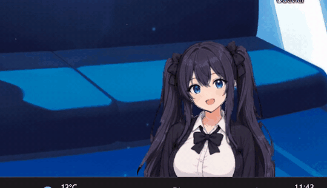
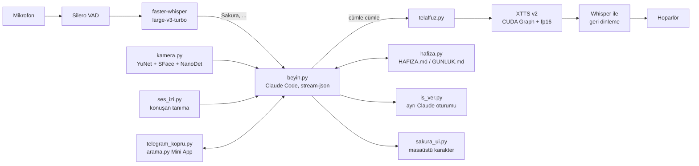

# Sakura — Türkçe Kişisel Sesli Asistan

> *A Jarvis-style Turkish voice assistant for Windows: wake word, local speech recognition, a custom Turkish voice,
> Claude Code as the brain, long-term memory, face/voice recognition and a Telegram bridge.*

Sakura, masaüstünde yaşayan, "Sakura" deyince uyanan ve kendine ait bir Türkçe sesle konuşan kişisel asistanım.
Bir bildirim botu olarak başladı; zamanla bilgisayarı kullanabilen, beni yüzümden ve sesimden tanıyan, dışarıdayken
Telegram'dan yazışıp sesli görüşebildiğim bir asistana dönüştü.

<p align="center"></p>

## Özellikler

- **Uyandırma kelimesiyle sesli sohbet** — "Sakura, …" ile başlayan cümleyi dinler; cevaptan sonra 8 sn boyunca tekrar
  adını söylemeden konuşmaya devam edilebilir.
- **Özel Türkçe ses** — XTTS v2 üzerinde kendi hazırladığım ses; duyguya göre (neşe, şaşkınlık, üzüntü…) değişen
  referans sesler, gülme/kıkırdama efektleri.
- **Kendi sesini denetleme** — üretilen her ses parçası Whisper ile geri dinlenir, benzerlik düşükse yeniden üretilir.
- **Telaffuz katmanı** — sayılar, saatler, yüzdeler ve yabancı kelimeler okunduğu gibi yazılır
  (ölçümde kusursuz cümle oranı %60 → %72, yanlış kelime %8,2 → %5,9).
- **Beyin: Claude Code** — sürekli açık duran bir Claude Code süreci; araç kullanabilir, ekrana bakabilir,
  uzun işleri ayrı bir oturuma devredip bitince haber verir.
- **Uzun süreli hafıza** — her konuşma günlüğe yazılır; asistan sessizken ayrı bir model kalıcı bilgileri ve günlük
  özeti çıkarır. "Bunu unut" komutuyla silinir.
- **Yüz ve ses tanıma** — OpenCV YuNet + SFace ile kim olduğunu, Chatterbox ses kodlayıcısıyla kimin konuştuğunu anlar;
  yabancı biri bilgisayara oturursa Telegram'dan fotoğraf gönderir.
- **Telegram köprüsü** — yazılı ve sesli mesajlaşma, Telegram Mini App üzerinden tarayıcıda sesli "arama".
- **Claude Code kancaları** — başka bir Claude oturumu soru sorduğunda veya izin istediğinde seçenekler Telegram'a
  düğmeli gelir; telefondan cevaplanır.
- **Kendi kendini iyileştirme** — haftalık olarak son 7 günün kayıtlarından küçük geliştirme önerileri üretir; onaylanan
  öneri ayrı bir oturumda uygulanır. Bir şey bozulursa Telegram'dan "Düzelt" düğmesiyle haber verir.
- **Arka plan görevleri** — gece modu, odak modu, günlük iş ilanı taraması.

## Mimari



| Dosya | Görev |
|---|---|
| `sakura_asistan.py` | Ana döngü: mikrofon → VAD → Whisper → beyin → XTTS → hoparlör |
| `beyin.py` | Sürekli açık Claude Code süreci; cevabı cümle cümle akıtır |
| `beyin/CLAUDE.md` | Kişilik ve davranış kuralları (örnek sürüm; asıl kişilik dosyası kişisel) |
| `hafiza.py` | Konuşma günlüğü ve arka planda hafıza özetleme |
| `hizli_xtts.py` | XTTS'in GPT kısmını CUDA Graph ile hızlandırır (dizüstünde ~5 kat) |
| `lora.py` | XTTS GPT'si için LoRA ince ayarı |
| `telaffuz.py`, `telaffuz_sozluk.txt` | Metni XTTS için okunduğu gibi yazar |
| `ses_izi.py`, `ses_kodlayici/` | Konuşmacı tanıma |
| `kamera.py` | Yüz tanıma, telefon tespiti, yabancı uyarısı |
| `telegram_kopru.py`, `tg_yaz.py` | Telegram yazışma ve bildirim |
| `arama.py`, `arama.html`, `ara_dino.py` | Telegram Mini App ile sesli arama (aiohttp + WebSocket) |
| `is_ver.py` | Uzun işleri ayrı Claude Code oturumuna verir |
| `karar_sor.py`, `karar_haber.py` | Claude Code kancaları: soruları/izinleri Telegram'a taşır |
| `gelisim.py`, `saglik.py` | Haftalık onaylı gelişim, hata bekçisi |
| `gorevler.py`, `is_avcisi.py` | Gece/odak modu, günlük iş ilanı taraması |
| `sakura_ui.py` | Masaüstü karaktere WM_COPYDATA ile olay gönderir |
| `karakter/` | Karakter ifadelerini üreten görüntü araçları (aşağıda) |

## Performans

RTX 3050 6 GB dizüstünde:

- Sohbet cevabı: ~3,7 sn (ilk cümlenin sesi)
- Ekrana bakarak cevap: ~6,6 sn
- Araç gerektiren işlerde "Hemen bakıyorum" hazır sesiyle ~2 sn
- Toplam GPU belleği: ~3,7 GB (XTTS GPT fp16, Whisper float16)

## Kurulum

Gereksinimler: Windows 10/11, NVIDIA GPU (6 GB+), Python 3.10, [Claude Code](https://docs.claude.com/en/docs/claude-code) (aboneliğe bağlı).

```powershell
git clone https://github.com/Ahmetrahatlik/sakura-voice-assistant.git sakura-araclar\jarvis
cd sakura-araclar
python -m venv ses\venv_xtts
ses\venv_xtts\Scripts\pip install -r jarvis\requirements.txt
```

1. **Modeller:** `kamera_model/README.md` ve `ses_kodlayici/KAYNAK.md` içindeki ağırlıkları indir.
   XTTS v2 ve faster-whisper modelleri ilk çalıştırmada iner.
2. **Ses referansı:** `sakura_asistan.py` içindeki `REF` ve `DUYGU_KLASOR` yolları `ses/ornekler/` altındaki referans
   .wav dosyalarını bekler. Kendi referans sesini oraya koy (ses verisi repoda yok).
3. **Telegram:** BotFather'dan bot oluştur, `setx SAKURA_TELEGRAM_TOKEN "<anahtar>"` ile anahtarı kaydet,
   `telegram.example.json` dosyasını `telegram.json` olarak kopyalayıp kendi chat ID'ni yaz.
4. **Kişilik:** `beyin/CLAUDE.md` içindeki `<KURULUM_KLASORU>` ifadelerini kendi kurulum yolunla değiştir.
5. **Başlat:** `powershell -ExecutionPolicy Bypass -File baslat.ps1` — yaklaşık 1–2 dk sonra "Kulağım açık" der.
   Durdurmak için `durdur.ps1`.

Mikrofonsuz test: `python sakura_asistan.py --dosya kayit.mp3` (kendi ses kaydınla)

## Karakter tasarımı

Sakura'nın görünüşünü (siyah saçlı anime kızı) Gemini, ChatGPT gibi araçlarla defalarca yeniden tasarladım.
Konuşurken ağız/göz hareketleri ve duygu ifadeleri için `karakter/` klasöründeki araçları yazdım:

- `sd_parca.py`, `sd_goz.py` — Stable Diffusion inpainting ile yalnızca göz/ağız bölgesini yeniden çizer
- `ifade_uret.py`, `tam_boy_ifade.py` — duygu ifadelerini (mutlu, şaşkın, utangaç, üzgün…) üretir
- `gemini_hizala.py`, `gemini_yapistir.py` — Gemini çıktısını referans yüze hizalayıp yumuşak maskeyle yapıştırır
- `iris_kaydir.py`, `degreen_uygula.py`, `onizle_renk.py` — göz bebeği kaydırma, yeşil ekran temizleme, renk önizleme

Inpainting modeli: **Mistoon Anime (inpainting)**, diffusers biçiminde `modeller/mistoon-inpaint/`. Ağırlıklar repoda
yok; kullanmak isteyen modeli kendi kaynağından indirip o sayfadaki lisansa uymalıdır.

## Lisanslar ve notlar

Bu proje kişisel kullanım için geliştirildi; repoda hiçbir model ağırlığı yoktur. Kullanılan modellerin lisansları:

- **XTTS v2** — Coqui Public Model License: yalnız ticari olmayan kullanım. Bu proje kişisel/portföy amaçlıdır.
- **Chatterbox VoiceEncoder** — MIT (Resemble AI).
- **OpenCV Zoo modelleri** — Apache-2.0.
- Kişisel veriler (hafıza, günlük, ses kayıtları, yüz/ses izleri, Telegram ayarları) bilerek repoya alınmamıştır;
  `.gitignore` bunları dışarıda tutar.

## Geçmiş

Sakura'dan önce [Klis](https://github.com/Ahmetrahatlik/klis-local-ai-assistant) adlı, araç kullanabilen yerel bir LLM
asistanı geliştirdim. Yerel Qwen modelleri (8B–24B) dizüstünde yavaş kaldığı için Sakura'nın beyni Claude Code'a taşındı.

---

Geliştiren: **Ahmet Rahatlık**
